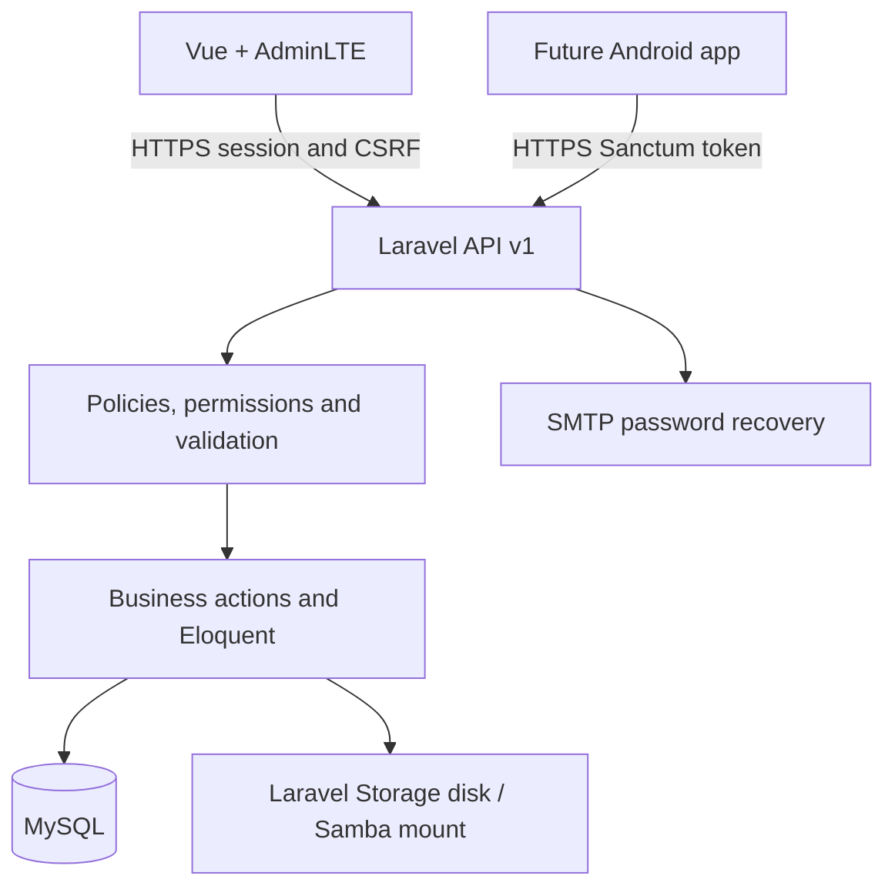

# Architecture

## Model

An API-first modular Laravel monolith with one installation per company. A single repository and deployment retain a logical separation between frontend and backend. Companies do not share a database, and the application uses no distributed services.

## Stack and dependencies

| Layer | Decision / proposal |
|---|---|
| Server | Apache, PHP and MySQL with a traditional installation |
| Backend | Stable, supported Laravel. Select its exact version in A, with compatible PHP and official extensions |
| Identity | Laravel 13.44.1 supplies sessions, validation and the password broker. Sanctum 4.5.0 supplies stateful SPA support and personal access tokens |
| Roles | Spatie Laravel Permission 8.5.1 supplies the reserved web guard `admin` role and effective permission names |
| Audit | Spatie Laravel Activitylog 5.1.5 supplies polymorphic actor and subject references, attribute changes and timestamped audit entries |
| Frontend | Vue 3 with the latest compatible stable AdminLTE. TypeScript and Vite are proposed. Use Vue Router or Pinia only when justified |
| UI | Evaluate SortableJS for dragging, FullCalendar, and Tabulator or a maintained Vue-compatible alternative in L |
| API | REST JSON v1 with OpenAPI. Scramble is a candidate |
| Tests/CI | Pest/PHPUnit, Vitest, Playwright and GitHub Actions. See TESTING and CI |

Install a package only when it is justified. Check actual compatibility, supported versions, maintenance, vulnerabilities, dependencies and cost. Record exact versions and lockfiles. Verify the Vue variant of AdminLTE in L before relying on any particular version's stability. Limit B frontend work to infrastructure and a minimal page for verifying the test harness.

The Phase C packages support Laravel 13. Activitylog requires PHP 8.4, the runtime already pinned in CI. Permission and Activitylog share the locked Laravel Package Tools 1.93.3 dependency. Activitylog supplies the audit persistence model and structured changes. Phase J will define the business events and retention operation.

## Laravel organization

- `routes/api.php` contains versioned endpoints grouped by resource and middleware.
- `app/Models` contains Eloquent models, relationships, casts and simple scopes.
- `app/Http/Controllers/Api/V1` adapts HTTP requests without complex logic.
- `app/Http/Requests` handles authorization and validation according to convention. `app/Http/Resources` defines explicit JSON representations.
- `app/Policies` handles permissions and access. Spatie manages the permission catalog and assignments.
- `app/Actions` or specific services handle multi-entity operations, numbering, creation from templates, moves, deletion and restoration, and Samba copies. Add these only when actual logic justifies them.
- `app/Console/Commands` handles administrative initialization, cleanup and necessary operational tasks with the Laravel scheduler.
- `database` contains migrations, factories and seeders. `lang/es`, `lang/ca` and `lang/en` contain translations. `resources/js` contains the SPA, components, views and API client.

Avoid generic repositories over Eloquent, buses, CQRS, Event Sourcing and ceremonial layers. Use transactions for invariants spanning multiple tables, write efficient queries and emit events only when they add value. Inject dependencies through constructors or methods. Use interfaces at real boundaries such as storage when they make testing easier without duplicating Storage. Keep models independent of HTTP and Vue.

## Identity and access

Prefer a same-origin SPA and API with secure session cookies, CSRF and stateful Sanctum. Android uses revocable tokens. Check permissions on every endpoint and enforce Policies regardless of token abilities. The administrator role allows sensitive management and permanent deletion. Additional roles must respect administrative restrictions. Initialize the administrator through a controlled command separate from application startup.

## Consistency and concurrency

Use MySQL/InnoDB, foreign keys, constraints and indexes. Allocate annual numbers within a transaction using a locked sequence row. Do not use `MAX()+1`. Keep Kanban moves atomic and distinguish global status, personal ordering and visibility. Restore only tasks deleted by the case deletion operation. Audit changes with an explicit actor and field differences, including asynchronous work where applicable.

## Samba

The operating system manages the SMB mount. Laravel Filesystem uses a configured root outside `public/`. Verify the mount itself because its directory can exist while it is unmounted. Prevent local disk fallback and use least privilege. Copy templates recursively and stream uploads. The proposal is to persist the original relative path and minimal provisioning indicators, retain the MySQL case when the external operation fails, and record an incident with an idempotent retry. MySQL and Samba do not share a distributed transaction. Design partial-failure recovery in I. Keep Samba contents intact and withhold paths and listings from clients. Report incidents separately from successful operations.

## Deployment

Use `public/` as the Apache document root, HTTPS, private `.env` configuration, `APP_DEBUG=false`, a cron-driven scheduler and corporate SMTP. Clients may need internal network or VPN access depending on the company. The company is responsible for MySQL, configuration and Samba backups and restoration. Document the requirements and upgrade procedure. CI builds and validates code and artifacts. Automatic deployment to user servers is out of scope.

## Phase D identity implementation

Laravel's native guards, session middleware, Sanctum, password broker and notification facilities supply the required flows without an additional package. The API passes credential mutations through the locked account row and uses an inline Laravel Gate for the administration boundary. Phase E adds the required explicit permission to that boundary. Recovery jobs use the existing encrypted database queue and send mail through configured SMTP with a trusted origin. Fortify adds no required mechanism for the selected endpoints. The existing welcome and test pages remain the available UI.

## Phase E policy boundaries

The administration routes use an inline Laravel Gate backed by the fixed web permission catalog. Spatie manages the roles and pivots. Its automatic Gate interception is disabled so that stored names cannot answer arbitrary policy abilities. The domain policies are discovered by Laravel from model names. The following are authorization calls for later endpoints and services.

| Operation | Gate arguments and context |
|---|---|
| Cases | Pass `Expedient::class` for collection and creation actions and an `Expedient` for record actions. Authorized access covers all cases. Apply the date, sequence, type and relation rules in the domain service. |
| Tasks | Pass `[Task::class, $expedient]` for collection and creation actions. Pass `[$task, $expedient]` for record actions. The policies enforce the declared case, its active state and visibility. |
| Comments and checklists | Pass the declared task and case along with the child for record actions. A comment author's identity does not restrict authorized edits. Checklist creation, mutation and ordering use `manage` on `[TaskChecklistItem::class, $task, $expedient]`, including the item for existing records. |
| Task templates | Pass the declared type with the template or its class for creation and list actions. `manageChecklist` takes the template, type and existing item when one is targeted. |
| Personal Kanban preferences | Pass `[ExpedientUserPreference::class, $expedient, $owner]` to `manage` and include the existing preference when present. Global case status mutation uses the case update policy. |
| Calendar | Pass `[$task, $expedient, $owner]` to `calendar`. Apply the equivalent assigned, active and dated predicates to collection queries. |
| Catalogs and incidents | Use the explicitly defined catalog and incident Gates with keys from the matrix. Return safe incident fields in I. |
| Uploads and tags | Check `upload` or `associateTags` on an accessible active case. Enforce storage and relationship invariants in the corresponding future service. |

Query current models in the specified parent scope and recheck contextual decisions at the service's locked write boundary. The preloaded model arguments identify the record, parent and owner. Phase E adds policies and tests without exposing unfinished routes.

### Trash, restoration and physical removal

Cases, tasks and task comments bind separate `delete`, `restore`, `forceDelete`, `viewAnyTrash` and `viewTrash` actions. Trash access requires a restore grant or the explicit administrator force-delete grant. Force deletion accepts a trashed record only. Task and comment actions use the declared active parent hierarchy and its access checks. To restore a case, F must select only trashed tasks carrying its `deleted_by_expedient` marker and authorize them with `restoreCascadeTask` on `[$expedient, $task]`. An independently deleted task stays in trash. G must reject independent restoration of a task bearing the cascade marker and hide children of inactive parents from ordinary queries. Restore order, cascades, locking and the physical writes belong to F/G. No operation deletes Samba data.

The catalog policy occupies the physical `delete` boundary for clients, types, statuses and tags. References to a client in either case role, to a type through a case or template, or to a status through a case or task block removal, including references from trash. H must retain the database's foreign-key enforcement and handle conflicts if references change after a policy decision. Tags and templates use their declared dependent-row cascades. Catalogs, templates and checklist items have no trash operations. Accounts retain disable/enable lifecycle only.

## Phase F shared boundaries for G, H and I

The existing `routes/api.php` Sanctum group loads `routes/expedients.php`. Client routes and the read-only type and status registrations remain in `routes/api.php`. Coordinate edits in these two files and the shared API, database, security and architecture documentation when the owner opens the next phases.

| Consumer | Contract |
|---|---|
| All domain writers | Call `App\Support\BusinessWrite::run(Request $request, PermissionKey $permission, Closure $operation): mixed`. The callback receives a freshly authorized `User` and runs in the guarded transaction. Take locks in the documented database order and keep external I/O outside. |
| G | Use `App\Support\ExpedientLifecycle::lockParent(int $id, bool $trashed = false): Expedient` inside the transaction. Regular child changes require the default active scope. Lock task rows after the parent. On reads, query active cases and their scoped children before applying the existing task policies. Follow the active-position uniqueness and collision rules in DATABASE.md. The case-level `delete(User $actor, int $id): void`, `restore(User $actor, int $id): Expedient` and `forceDelete(User $actor, int $id): void` methods own cascade state. |
| H | The lookup responses are `ExpedientTypeResource` and `StatusResource`. `App\Support\CaseOrdering::lockStatuses(int ...$ids): void` and `appendTo(int $statusId): int` serialize case positions with the established write guard. Call `App\Support\ExpedientWriter::update(User $actor, int $id, array $input): Expedient` for validated case fields and status changes. Personal ordering reconciles stale or missing entries from base position and ID while retaining each user's hidden flag. For operations across cases, lock case IDs in sorted order before statuses. Catalog-only removal uses the FK and the catalog policy without taking case locks after a status lock. |
| I | `App\Support\ExpedientWriter::create(User $actor, array $input): Expedient` returns the case within its write transaction. Once the outer `BusinessWrite` returns to the HTTP entry point, the committed case ID, immutable assigned code, name and type are available. Start storage provisioning after commit, and use that same identity for retries. Keep `samba_relative_path` private, retain incident code snapshots and exclude storage deletion from case removal. Define partial-success and recovery in I. |
| J | The write boundary knows the actual actor and case ID. Later auditing must record appropriate business diffs and relationship changes without secrets. Define event policy, retention and audit visibility in J. |

Template copying, when H adds it, must persist its database rows inside the same creation transaction as the case and number. G/H/I may proceed together only after owner acceptance of F. Before their integration, jointly verify parent deletion versus task creation or modification, restore collisions and markers, shared status lock ordering, preference preservation and post-commit storage failures without renumbering.

## Phase I storage identity

The Phase I adapter has dedicated settings in `config/samba.php`. Installation config identifies the exact private Linux CIFS mountpoint and expected UNC source. The template and case roots are separate, relative, case-insensitively disjoint subtrees. The installation provisions both roots. The last two digits of the assigned case code select the template directory, including on retries after type changes.

The case intent keeps the original relative path. Its folder name begins with the nine-digit code and a single space. The name portion uses NFC Unicode, replaces unsafe characters with underscores and trims trailing dots and spaces. It is truncated on a UTF-8 boundary to fit a 255-byte component, with an underscore for an empty result. A malformed case-root setting reserves the canonical default path in MySQL while storage operations fail configuration validation. Correcting that configuration must agree with the reserved path. Case names in MySQL retain their business value.

The adapter will claim only a directory it creates. Private signed markers bind ownership, template revision and verified completion to the case identity and installation. A preexisting unclaimed directory, including one left by a crash after directory creation and before the claim is recorded, requires operator review.

I serializes each case's provisioning, retry and upload with a nonblocking kernel lock. The private local lock directory must be shared by all PHP workers for an installation on the same Linux host. Use one storage-writing host per database and share. The bounded lock slots can occasionally make unrelated requests briefly contend. The lock has no expiring lease and closes on process exit.

The storage operation performs a fresh authorization and active-case check under short database locks before I/O and before confirming success. Already admitted operations can write while a case or credential is being revoked. The final check withholds confirmation when access changes. Lifecycle operations leave share contents untouched.

Legacy cases with no reference receive one during explicit retry, using their current name and immutable code suffix. A retry checks signed ownership, compares any partial files to the original template revision and fills missing items only. Completion is reserved in MySQL before writing its signed marker. Losing a previously ready directory, seeing a differing partial file or encountering unclaimed content requires operator review. A verified ready retry leaves documents alone even when the template has changed.
