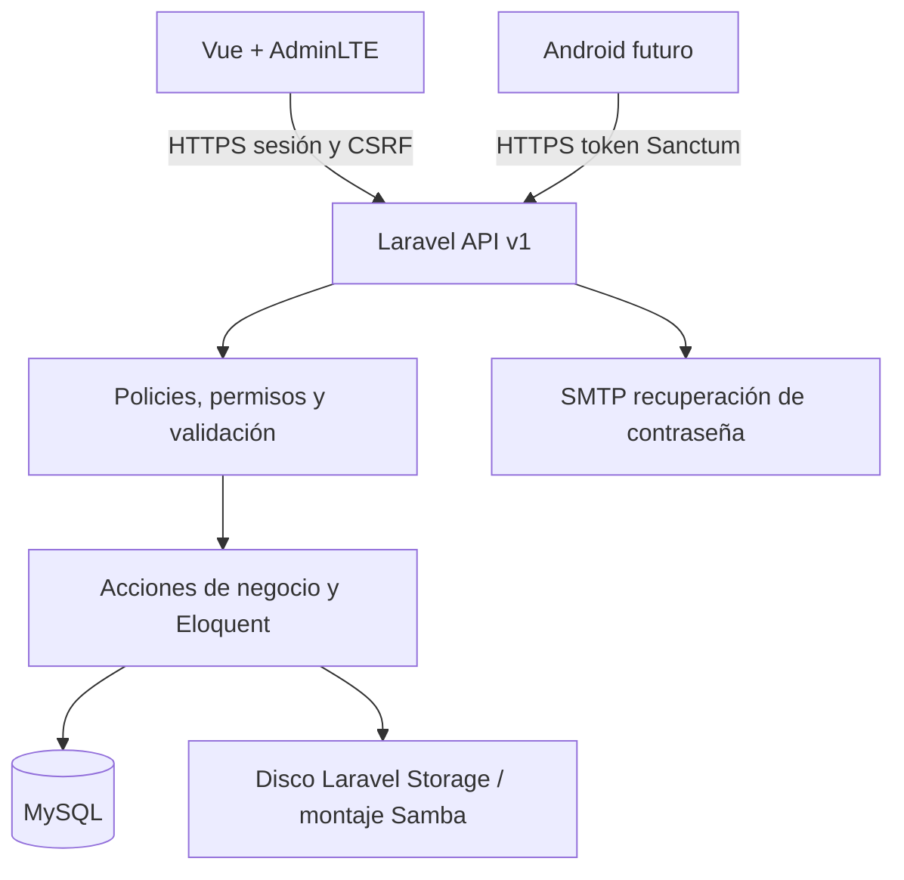

# Arquitectura

## Modelo

Monolito modular Laravel, API First, una instalación por empresa. Un repositorio y despliegue; separación lógica del frontend y backend. No servicios distribuidos ni base de datos compartida entre empresas.

## Stack y dependencias

| Capa | Decisión / propuesta |
|---|---|
| Servidor | Apache, PHP, MySQL; instalación tradicional |
| Backend | Laravel estable y soportado; seleccionar versión exacta en A, PHP compatible y extensiones oficiales |
| Identidad | Sanctum (confirmado); Fortify para autenticación sin UI propia, propuesta |
| Roles | Spatie Laravel Permission (confirmado) |
| Auditoría | Spatie Laravel Activitylog, propuesta a validar |
| Frontend | Vue 3 + AdminLTE estable más reciente compatible, TypeScript y Vite propuestos; Vue Router, Pinia solo si se justifica |
| UI | SortableJS para arrastre, FullCalendar, Tabulator u opción mantenida con soporte Vue, a validar en L |
| API | REST JSON v1; OpenAPI, Scramble como candidato |
| Tests/CI | Pest/PHPUnit, Vitest, Playwright, GitHub Actions; ver TESTING y CI |

No instalar paquetes solo por aparecer en esta tabla. Comprobar compatibilidad real, versiones soportadas, mantenimiento, vulnerabilidades, dependencias y coste. Registrar versiones exactas y lockfiles. La variante Vue de AdminLTE requiere verificación efectiva en L; no asumir que una versión concreta está estable. No anticipar funcionalidades frontend en B: solo infraestructura y una página mínima para verificar el harness.

## Organización Laravel

- `routes/api.php`: endpoints versionados, agrupados por recursos y middleware.
- `app/Models`: Eloquent, relaciones, casts y scopes simples.
- `app/Http/Controllers/Api/V1`: adaptación HTTP, sin lógica compleja.
- `app/Http/Requests`: autorización/validación según convención; `app/Http/Resources`: representación JSON explícita.
- `app/Policies`: permisos y acceso; Spatie para catálogo y asignación.
- `app/Actions` o servicios concretos: operaciones multientidad, numeración, creación desde plantilla, movimiento, eliminación/restauración, copia Samba. Crear solo cuando exista lógica que lo justifique.
- `app/Console/Commands`: inicialización administrativa, limpieza y tareas operativas necesarias; scheduler de Laravel.
- `database`: migraciones, factories, seeders; `lang/es`, `lang/ca`, `lang/en`; `resources/js`: SPA, componentes, vistas y cliente API.

Evitar repositorios genéricos sobre Eloquent, buses, CQRS, Event Sourcing y capas ceremoniales. Usar transacciones para invariantes multitabla, consultas eficientes, eventos solo cuando aporten valor. Inyectar dependencias por constructor o método; usar interfaces en límites reales como almacenamiento si facilitan el test sin duplicar Storage. No acoplar modelos a HTTP ni a Vue.

## Identidad y acceso

SPA y API en mismo origen preferentemente; cookies de sesión seguras, CSRF y Sanctum stateful. Android usa tokens revocables. Los permisos se comprueban en cada endpoint; capacidades de token no sustituyen Policies. El rol administrativo permite gestión sensible y eliminación definitiva. Roles adicionales no pueden soslayar restricciones administrativas. Bootstrap del administrador por comando controlado, no por cada arranque.

## Consistencia y concurrencia

MySQL/InnoDB, claves foráneas, constraints e índices. Numeración anual mediante fila de secuencia bloqueada en transacción, nunca `MAX()+1`. Movimientos Kanban atómicos; distinguir estado global, orden personal y visibilidad. Restaurar solo tareas borradas por la operación de borrado del expediente. Auditoría de cambios mediante actor explícito y diferencias, incluido trabajo asíncrono si existe.

## Samba

Montaje SMB gestionado por el sistema operativo; Laravel Filesystem sobre raíz configurada fuera de `public/`. Validar disponibilidad real del montaje (no solo existencia del directorio), evitar fallback al disco local si se desmonta, permisos mínimos. Copia recursiva de plantilla y subida en streaming. Propuesta: persistir ruta relativa original e indicadores mínimos de aprovisionamiento; mantener expediente MySQL ante fallo externo y registrar incidencia, con reintento idempotente. No hay transacción distribuida MySQL/Samba: diseñar recuperación de fallos parciales en I. No borrar contenidos Samba, ni exponer rutas o listados al cliente. Una incidencia no debe confundirse con operación completada correctamente.

## Despliegue

Document root Apache `public/`, HTTPS, configuración `.env` privada, `APP_DEBUG=false`, scheduler por cron, SMTP corporativo. Recursos de red interna o VPN para clientes según empresa. Backups y restauración de MySQL, configuración y Samba a cargo de la empresa; documentar requisitos y procedimiento de actualización. CI produce y valida código/build, nunca despliega a servidores de usuarios automáticamente.
