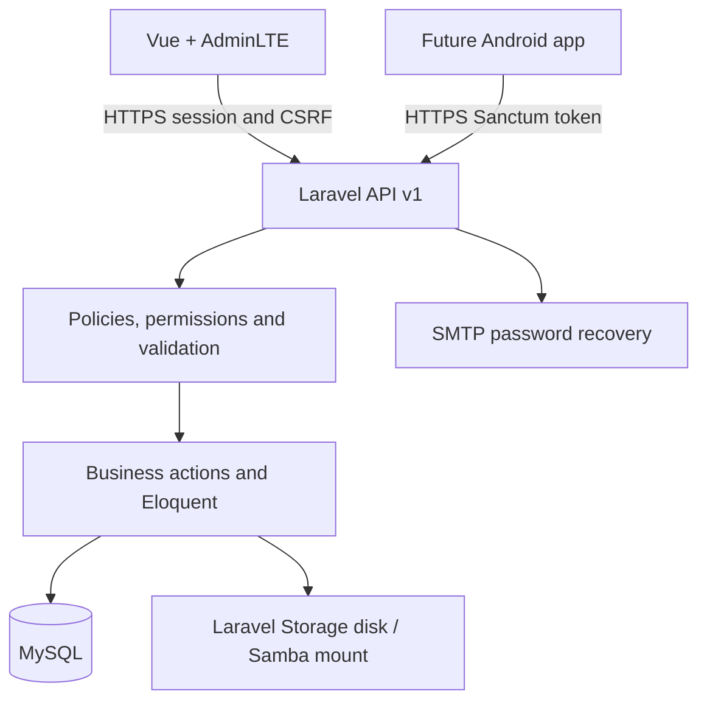

# Architecture

## Model

An API-first modular Laravel monolith with one installation per company. A single repository and deployment retain a logical separation between frontend and backend. Companies do not share a database, and the application uses no distributed services.

## Stack and dependencies

| Layer | Decision / proposal |
|---|---|
| Server | Apache, PHP and MySQL with a traditional installation |
| Backend | Stable, supported Laravel. Select its exact version in A, with compatible PHP and official extensions |
| Identity | Laravel Sanctum 4.5.0 supplies the token schema. Fortify is proposed for authentication without its own UI |
| Roles | Spatie Laravel Permission 8.5.1 supplies the role and permission schema |
| Audit | Spatie Laravel Activitylog 5.1.5 supplies polymorphic actor and subject references, attribute changes and timestamped audit entries |
| Frontend | Vue 3 with the latest compatible stable AdminLTE. TypeScript and Vite are proposed. Use Vue Router or Pinia only when justified |
| UI | Evaluate SortableJS for dragging, FullCalendar, and Tabulator or a maintained Vue-compatible alternative in L |
| API | REST JSON v1 with OpenAPI. Scramble is a candidate |
| Tests/CI | Pest/PHPUnit, Vitest, Playwright and GitHub Actions. See TESTING and CI |

Install a package only when it is justified. Check actual compatibility, supported versions, maintenance, vulnerabilities, dependencies and cost. Record exact versions and lockfiles. Verify the Vue variant of AdminLTE in L before relying on any particular version's stability. Limit B frontend work to infrastructure and a minimal page for verifying the test harness.

The Phase C packages support Laravel 13. Activitylog requires PHP 8.4, the runtime already pinned in CI. Permission and Activitylog share the locked Laravel Package Tools 1.93.3 dependency. Activitylog supplies the audit persistence model and structured changes. Phase J will define the business events and retention operation.

## Laravel organization

- `routes/api.php` contains versioned endpoints grouped by resource and middleware.
- `app/Models` contains Eloquent models, relationships, casts and simple scopes.
- `app/Http/Controllers/Api/V1` adapts HTTP requests without complex logic.
- `app/Http/Requests` handles authorization and validation according to convention. `app/Http/Resources` defines explicit JSON representations.
- `app/Policies` handles permissions and access. Spatie manages the permission catalog and assignments.
- `app/Actions` or specific services handle multi-entity operations, numbering, creation from templates, moves, deletion and restoration, and Samba copies. Add these only when actual logic justifies them.
- `app/Console/Commands` handles administrative initialization, cleanup and necessary operational tasks with the Laravel scheduler.
- `database` contains migrations, factories and seeders. `lang/es`, `lang/ca` and `lang/en` contain translations. `resources/js` contains the SPA, components, views and API client.

Avoid generic repositories over Eloquent, buses, CQRS, Event Sourcing and ceremonial layers. Use transactions for invariants spanning multiple tables, write efficient queries and emit events only when they add value. Inject dependencies through constructors or methods. Use interfaces at real boundaries such as storage when they make testing easier without duplicating Storage. Keep models independent of HTTP and Vue.

## Identity and access

Prefer a same-origin SPA and API with secure session cookies, CSRF and stateful Sanctum. Android uses revocable tokens. Check permissions on every endpoint and enforce Policies regardless of token abilities. The administrator role allows sensitive management and permanent deletion. Additional roles must respect administrative restrictions. Initialize the administrator through a controlled command separate from application startup.

## Consistency and concurrency

Use MySQL/InnoDB, foreign keys, constraints and indexes. Allocate annual numbers within a transaction using a locked sequence row. Do not use `MAX()+1`. Keep Kanban moves atomic and distinguish global status, personal ordering and visibility. Restore only tasks deleted by the case deletion operation. Audit changes with an explicit actor and field differences, including asynchronous work where applicable.

## Samba

The operating system manages the SMB mount. Laravel Filesystem uses a configured root outside `public/`. Verify the mount itself because its directory can exist while it is unmounted. Prevent local disk fallback and use least privilege. Copy templates recursively and stream uploads. The proposal is to persist the original relative path and minimal provisioning indicators, retain the MySQL case when the external operation fails, and record an incident with an idempotent retry. MySQL and Samba do not share a distributed transaction. Design partial-failure recovery in I. Keep Samba contents intact and withhold paths and listings from clients. Report incidents separately from successful operations.

## Deployment

Use `public/` as the Apache document root, HTTPS, private `.env` configuration, `APP_DEBUG=false`, a cron-driven scheduler and corporate SMTP. Clients may need internal network or VPN access depending on the company. The company is responsible for MySQL, configuration and Samba backups and restoration. Document the requirements and upgrade procedure. CI builds and validates code and artifacts. Automatic deployment to user servers is out of scope.
