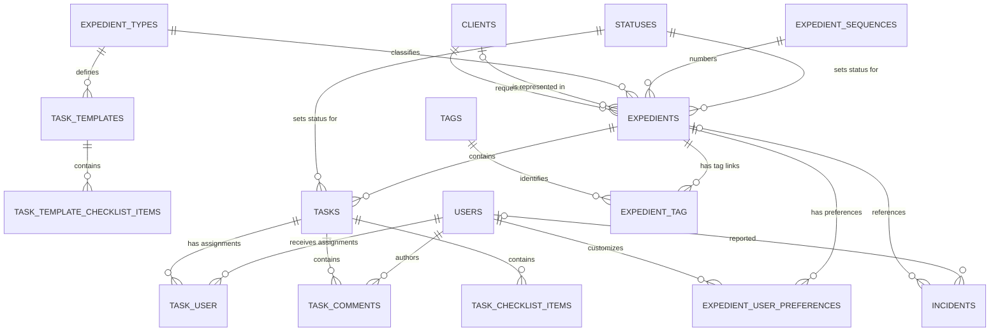

# Database

## Conventions

Use MySQL 8.4, InnoDB and `utf8mb4`. Domain tables use unsigned bigint surrogate keys unless the dictionary identifies a natural or composite key. Fields are required with no default unless marked nullable or assigned a default. Laravel timestamps are nullable `TIMESTAMP` columns. `deleted_at` is a nullable technical `TIMESTAMP` for restorable records. PHP and the MySQL session use `APP_TIMEZONE` so MySQL can convert technical timestamps to UTC for storage. Provision MySQL time zone data for named zones. Laravel serializes technical timestamps as UTC ISO 8601. A task's functional date and time are civil values in the installation time zone.

Client and tag names preserve case, accents and interior whitespace as entered. Eloquent trims surrounding Unicode whitespace. MySQL rejects blank or untrimmed names and compares names with `utf8mb4_0900_ai_ci` for uniqueness, ignoring case and accents. For example, `Café` and `CAFE` identify the same name. Interior spaces can distinguish names. Codes and hex colors use ASCII binary collation.

## Field dictionary

`ID` denotes an unsigned bigint foreign key or surrogate key. `Position` denotes an unsigned bigint ordering key. Unless specified, foreign keys restrict parent deletion and do not support rekeying. MySQL indexes foreign keys when no declared key covers them.

| Table | Columns and defaults | Keys, constraints and deletion |
|---|---|---|
| `users` | `id` ID, `name` VARCHAR(255), `email` VARCHAR(255), `email_verified_at` TIMESTAMP nullable, `password` VARCHAR(255) hash, `remember_token` VARCHAR(100) nullable, `locale` CHAR(2) default `es`, timestamps | PK `id`, unique `email`. Enforce lowercase `es`, `ca` or `en`. Existing users receive the default locale on upgrade. |
| `sessions` | `id` VARCHAR(255), `user_id` ID nullable, `ip_address` VARCHAR(45) nullable, `user_agent` TEXT nullable, `payload` LONGTEXT, `last_activity` INT | Laravel session schema, PK `id`. Indexes on `user_id` and `last_activity`. The framework owns session invalidation. |
| `password_reset_tokens` | `email` VARCHAR(255), `token` VARCHAR(255), `created_at` TIMESTAMP nullable | Laravel password broker schema, PK `email`. |
| `personal_access_tokens` | `id` ID, `tokenable_type` VARCHAR(255), `tokenable_id` ID, `name` TEXT, `token` VARCHAR(64) hash, `abilities` TEXT nullable, `last_used_at`, `expires_at` TIMESTAMP nullable, timestamps | Sanctum schema, PK `id`, unique `token`, indexes on polymorphic owner and `expires_at`. |
| `roles`, `permissions` | `id` ID, `name`, `guard_name` VARCHAR(255), timestamps | Spatie schema without teams. PK `id`, unique `(name, guard_name)` in each table. Use the `web` guard. |
| `model_has_roles`, `model_has_permissions` | `role_id` or `permission_id` ID, `model_type` VARCHAR(255), `model_id` ID | Spatie composite PK across the three fields and index on `(model_id, model_type)`. Deleting the role or permission removes its assignments. Models use polymorphic references. |
| `role_has_permissions` | `permission_id`, `role_id` IDs | Composite PK across the pair. Physical role or permission deletion cascades. |
| `cache`, `cache_locks` | `key` VARCHAR(255), `expiration` BIGINT, `value` MEDIUMTEXT (cache), `owner` VARCHAR(255) (locks) | Laravel support, PK `key`, index on `expiration`. |
| `jobs` | `id` ID, `queue` VARCHAR(255), `payload` LONGTEXT, `attempts` SMALLINT UNSIGNED, `reserved_at` INT UNSIGNED nullable, `available_at`, `created_at` INT UNSIGNED | PK `id`, index on `queue`. Queue integers represent epoch seconds. |
| `job_batches` | `id`, `name` VARCHAR(255), `total_jobs`, `pending_jobs`, `failed_jobs`, `created_at` INT, `failed_job_ids` LONGTEXT, `options` MEDIUMTEXT nullable, `cancelled_at`, `finished_at` INT nullable | PK `id`. |
| `failed_jobs` | `id` ID, `uuid` VARCHAR(255), `connection`, `queue` VARCHAR(255), `payload`, `exception` LONGTEXT, `failed_at` TIMESTAMP default current timestamp | PK `id`, unique `uuid`, index on `(connection, queue, failed_at)` as generated by the installed Laravel schema. |
| `clients` | `id` ID, `name` VARCHAR(255), timestamps | PK `id`, unique normalized `name`. References through either client role restrict deletion. |
| `expedient_types` | `id` ID, `name` VARCHAR(255), `code` CHAR(2), timestamps | PK `id`, unique code with two ASCII digits. Type references from cases and templates restrict deletion. |
| `expedient_sequences` | `year` SMALLINT UNSIGNED, `last_number` SMALLINT UNSIGNED default 0 | PK `year`, checks for year 1000–9999 and counter 0–999. Keep sequence rows permanently, including after all cases for that year are removed. |
| `statuses` | `id` ID, `name` VARCHAR(255), `name_translations` JSON nullable, `position` Position, timestamps | PK `id`, index on `(position, id)`. References from live and soft-deleted cases and tasks restrict deletion. |
| `expedients` | `id` ID, `code` CHAR(9), `year`, `sequence_number` SMALLINT UNSIGNED, `expedient_type_id`, `requester_client_id`, `status_id` IDs, `represented_client_id` ID nullable, `name` VARCHAR(255), `description` TEXT nullable, `column_position` Position, `column_version` BIGINT UNSIGNED default 1, `samba_relative_path` VARCHAR(1024) nullable, timestamps, `deleted_at` | PK `id`, unique `code` and `(year, sequence_number)`. Checks enforce nine digits, agreement between the first seven digits and the persisted year and sequence, range 1–999 and distinct client roles when represented. Mandatory annual sequence row, type, requester and explicit status. Index on `(status_id, deleted_at, column_position, id)`. |
| `tasks` | `id` ID, `expedient_id`, `status_id` IDs, `name` VARCHAR(255), `description` TEXT nullable, `scheduled_date` DATE nullable, `scheduled_time` TIME nullable, `position` Position, `active_position` generated BIGINT UNSIGNED nullable, `deleted_by_expedient` BOOLEAN default false, timestamps, `deleted_at` | PK `id`, unique `(expedient_id, status_id, active_position)`. A time requires a date and must lie between 00:00:00 and 23:59:59. A cascade marker requires soft deletion. Indexes on `(expedient_id, status_id, deleted_at, position)` and `(scheduled_date, deleted_at)`. Physical deletion of the parent cascades. |
| `task_user` | `task_id`, `user_id` IDs | Composite PK `(task_id, user_id)`. Physical deletion of either side cascades. |
| `task_comments` | `id` ID, `task_id`, `author_user_id` IDs, `body` TEXT, timestamps, `deleted_at` | PK `id`, index on `(task_id, deleted_at, created_at, id)`. Physical task deletion cascades. Author deletion is restricted. |
| `task_checklist_items` | `id` ID, `task_id` ID, `name` VARCHAR(255), `completed` BOOLEAN default false, `position` Position, timestamps | PK `id`, index on `(task_id, position, id)`. Check `completed` is 0 or 1. Physical task deletion cascades. |
| `task_templates` | `id` ID, `expedient_type_id` ID, `name` VARCHAR(255), `description` TEXT nullable, `position` Position, timestamps | PK `id`, index on `(expedient_type_id, position, id)`. Templates carry no assignees or dates. |
| `task_template_checklist_items` | `id` ID, `task_template_id` ID, `name` VARCHAR(255), `position` Position, timestamps | PK `id`, index on `(task_template_id, position, id)`. Physical template deletion cascades. |
| `tags` | `id` ID, `name` VARCHAR(255), `color` CHAR(7), timestamps | PK `id`, unique normalized `name`. Color is `#` followed by six hexadecimal digits. |
| `expedient_tag` | `expedient_id`, `tag_id` IDs | Composite PK `(expedient_id, tag_id)`. Physical deletion of either side removes the link. |
| `expedient_user_preferences` | `id` ID, `user_id`, `expedient_id` IDs, `position` Position nullable, `column_version` BIGINT UNSIGNED nullable, `hidden` BOOLEAN default false, timestamps | PK `id`, unique `(user_id, expedient_id)`. Position and version must both be present or both be null. Check `hidden` is 0 or 1. Physical deletion of either side cascades. |
| `seeded_catalogs` | `catalog` VARCHAR(64) | PK `catalog`. Records completed initializations independently of individual catalog records. |
| `activity_log` | `id` ID, `log_name` and `event` VARCHAR(255) nullable, `description` TEXT, `subject_type` and `causer_type` VARCHAR(255) nullable, `subject_id` and `causer_id` IDs nullable, `attribute_changes` and `properties` JSON nullable, timestamps | PK `id`, indexes on `(subject_type, subject_id)`, `(causer_type, causer_id)`, `log_name` and `created_at`. Polymorphic references have no SQL foreign keys and survive deletion of either record. |
| `incidents` | `id` ID, `user_id`, `expedient_id` IDs nullable, `expedient_code` CHAR(9) nullable, `type`, `operation` VARCHAR(64), `message` TEXT, `context` JSON nullable, `created_at` TIMESTAMP default current timestamp | PK `id`, indexes on `created_at` and `(expedient_code, created_at)`. A case code snapshot has nine ASCII digits. Physical deletion of an actor or case sets its live FK to null. The case code snapshot remains. |
| `migrations` | `id` INT UNSIGNED, `migration` VARCHAR(255), `batch` INT | Laravel's migration ledger, PK `id`. |

## Relationships

## Database invariants and later workflows

- **Numbering (F).** Allocate against the installation time zone using one row per year across all types. Create the annual row safely under concurrency, select it for update, advance the counter and insert the case in one transaction with bounded retries for deadlocks. The counter and the case success must commit together. MySQL enforces the stored format, range and uniqueness and retains the counter when a case is deleted. Phase F prevents reuse of committed numbers, counter rewind and edits to assigned type or case codes. At creation it matches the last two code digits to the selected type. Later reclassification can update the type relationship while the assigned code stays intact.
- **Deletion and restoration (F/G).** A case can be soft deleted more than once across restoration cycles. Each task's `deleted_by_expedient` marker belongs to its single parent and indicates membership in the current cascade. Set it only when soft deleting a previously active task during the case operation. Clear it in the same transaction that restores those tasks and the case. Prior task deletions remain untouched. The later services coordinate parent and child state and exclude child resources of deleted parents. Soft deletion retains assignments, comments, checklists and other relationships. Physical deletion cascades only to dependent database rows and leaves Samba untouched.
- **Scheduling (G).** `NULL` date and time mean unscheduled. A date with `NULL` time is all day. A date with 00:00:00 is a task scheduled at midnight. Calendar visibility follows the task and its assignees. There are no additional functional dates.
- **Catalogs and ordering (H).** The initial six shared statuses keep a single row each with Spanish as the initial name and localized labels for Spanish, Catalan and English. A transactional seed marker survives edits and deletions. Later administrator renames replace the name and clear the initial translations together so the customized label is shown in every language. New case entries use the status column's base order with ID as the tie-breaker. Moving to a new status assigns a new column position, increments `column_version` and preserves `hidden`. A personal position applies only to a matching entry version. The service reconciles base order and sparse preferences so new entries appear at the end of existing personal orders. Task positions are shared per case and status. Soft-deleted tasks have no active position, allowing the slot to be reused. Restoration allocates a valid slot if needed. Templates copy into independent tasks without a source template FK.
- **Samba and incidents (I).** Persist the original relative case folder reference when provisioning. The case model hides this field from default serialization. Phase I validates the path, decides provisioning and retry behavior and writes a safe case code snapshot to case-related incidents. Never write credentials, absolute paths, binary data or file inventories. Phase I remains responsible for handling external operations.
- **Audit (J).** Persist actor, subject, event and changed fields through Activitylog. Index the audit creation date for future one-year cleanup. Phase J owns recording, redaction, relationship snapshots and retention. Incident retention is still undecided.

## Migration order and verification

The original Laravel users, sessions, reset, cache and jobs migrations remain unchanged. Add locale and the package schemas, then clients, case types, annual sequences, statuses and cases. Tasks follow cases. Templates, tags and personal preferences follow their parents. Activitylog and incidents complete the schema. Reverse in dependency order on a disposable database. Rolling back Phase C drops domain data and locale values. Back up existing installations and prefer a corrective forward migration for production data.

After applying migrations, run `php artisan db:seed --force` to initialize the shared status catalog. The default seeder creates no accounts or demonstration records. Domain models use Eloquent's default mass-assignment guard. Factories and the initial status seeder supply trusted values explicitly. The business feature phases define their authorized write fields.

## Phase D account lifecycle

The forward migration adds nullable `users.disabled_at TIMESTAMP` and `users.auth_version BIGINT UNSIGNED NOT NULL DEFAULT 0`. Existing accounts remain active and keep password hashes, locales and relationships. The session generation rejects stale sessions even if a concurrent response writes an old session after bulk deletion. Rolling back drops both columns and therefore discards disabled state and generation history. Treat rollback as a maintenance operation.

## Phase E authorization installation and upgrades

Phase E reuses the Spatie tables and adds no migrations. After applying migrations, run `php artisan db:seed --force` before serving traffic on an upgrade from D. The authorization seeder creates the fixed `web` permission catalog and the protected `admin` and `user` roles. It preserves existing IDs, memberships, grants and account attributes. The `authorization_v1` marker makes the initial ordinary-role grant and existing non-admin account backfill one-time operations. Active and disabled ordinary accounts receive that role in addition to existing assignments. Removing the ordinary role or changing its grants is persistent across seeds. A repeat seed also repairs missing essential administrator grants. Future catalog additions require an explicit decision about which roles receive them.

Either general seeding or `php artisan expedflow:admin:init` can run first on a fresh installation. Only the explicit initializer creates an account or assigns initial admin membership. A pending marker identifies an empty reserved role created by the catalog installer. A previously existing empty role without this marker, an unrelated identity with the configured email, or conflicting existing administrators require owner review. Delete bootstrap secrets and refresh cached configuration after initialization. The catalog and its markers are transactional.
