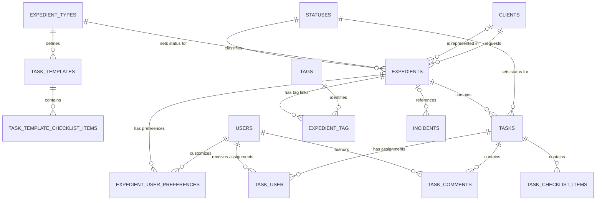

# Database — logical design before C

Use MySQL, InnoDB, utf8mb4, foreign keys and constraints. Select a supported MySQL version in A. CI uses the same reference engine and version. This document defines entities and invariants. Functional migrations belong exclusively to C. The following names and types are technical proposals except where functional limits are explicit.

## Catalog

| Table | Main logical fields / relationships |
|---|---|
| `users` | id, name, unique email, password hash, locale and technical fields for account management |
| `sessions`, `password_reset_tokens`, `personal_access_tokens` | Laravel/Sanctum migrations |
| `roles`, `permissions`, `model_has_roles`, `model_has_permissions`, `role_has_permissions` | Spatie migrations with a consistent guard for users |
| `clients` | id, unique name and technical timestamps |
| `expedient_types` | id, name, unique code CHAR(2) and technical timestamps |
| `expedient_sequences` | unique year key and last_number 0–999 |
| `statuses` | id, name, global order and technical timestamps in a shared catalog |
| `expedients` | id, unique code CHAR(9), year, sequence_number, expedient_type_id, name, nullable description, requester_client_id, nullable represented_client_id, status_id, technical timestamps and soft delete |
| `expedient_user_preferences` | user_id, expedient_id, nullable personal position, hidden, technical timestamps and UNIQUE(user_id, expedient_id) |
| `tasks` | id, expedient_id, status_id, name, nullable description, nullable date, nullable time, global position, technical timestamps and soft delete |
| `task_user` | task_id, user_id, UNIQUE(task_id,user_id) |
| `task_checklist_items` | id, task_id, name, completed, position and technical timestamps, with no functional date |
| `task_comments` | id, task_id, author user_id, body, technical timestamps and deletion strategy |
| `task_templates` | id, expedient_type_id, name, nullable description and position, with no users or dates |
| `task_template_checklist_items` | id, task_template_id, name and position |
| `tags` | id, unique name, configurable color and technical timestamps |
| `expedient_tag` | expedient_id, tag_id, with UNIQUE on the pair |
| `activity_log` | Audit package schema with actor, entity, operation, changes and date |
| `incidents` | id, nullable user_id, nullable expedient_id, type, operation, message, minimal context and created_at. Retain a useful historical reference |

Include standard Laravel support tables such as cache/jobs only when needed. In C, add the schemas needed by backend dependencies and defer authentication and business flows. The design excludes tables for companies, documents, notifications and a separate calendar.

## Relationships

## Invariants and design criteria

- A type code has two ASCII digits and preserves leading zeroes. A case code has nine digits. Validate in the application and database where feasible. Use unique indexes on code and `(year, sequence_number)`. These fields are immutable after assignment. Determine the year in the installation's time zone. Retain the sequence row when cases are deleted. Define a transaction with `SELECT ... FOR UPDATE` (Eloquent `lockForUpdate`), safe concurrent creation of a new annual row and bounded deadlock retries. Block numbering beyond 999 and do not reuse numbers from committed cases.
- For unique client and tag names, explicitly choose the collation and normalization of whitespace, case and accents in C. Test the selected semantics. Reuse catalog keys only if historical identity can be preserved.
- The proposed date and time fields are `scheduled_date DATE NULL` and `scheduled_time TIME NULL`, with a constraint allowing a time only when a date is present. They represent one functional date. Distinguish all-day values from midnight. Cases, checklists and templates have no dates. Use UTC for technical timestamps where appropriate and interpret functional date and time values in the installation's time zone.
- Use restrictive status foreign keys, including for soft-deleted records. Prevent deletion of statuses in use. Make column order configurable. Use a stable, idempotent initial seed that preserves user-modified statuses and their deletion state. Define initial status translations without duplicating catalogs or breaking customizations.
- Store case Kanban preferences sparsely and avoid creating a row for every pair at creation time. Use a deterministic base order for column entry. `created_at` alone cannot order moves. Place new entries at the end of each personal order. Use ordering keys and column versions with current preferences, or an equivalent transactional update. Invalidate the old position on a status change and retain `hidden`. Test simultaneous moves, new users, hidden cards and the absence of collisions. Task order is unique per case and status, with a deterministic tie-breaker.
- For soft deletion, distinguish tasks deleted by a case's logical cascade from previously deleted tasks using an operation marker or auxiliary foreign key. Restore only tasks from that cascade. Keep dependencies while the parent can be restored. Authorize hard deletion in the backend, document SQL cascades or explicit actions, and protect referenced catalogs. Keep deletion foreign keys independent of Samba operations.
- Audit relevant differences, the actor and a historical reference. Omit passwords, tokens and binary content. Retain history for one year with a date index and scheduled cleanup. Preserve incidents after case deletion using a safe historical reference and a nullable foreign key where appropriate.
- For Samba, the proposal is to store the original relative path and minimal operational state on the case or a dedicated technical entity. Keep file inventories, sensitive absolute paths and credentials out of the database.

## Phase C deliverables

Deliver the final dictionary of fields, types, nullability, defaults, indexes, uniqueness, foreign keys and deletion rules. Include reversible migrations where reasonable, models, relationships, casts, factories, idempotent seeders, synthetic fixtures and tests. Verify installation from an empty database, migrate/rollback/migrate, constraints directly in the database, relationships, dates, translations and catalogs. Add business logic cases that depend on later services when those services are implemented and report only coverage achieved in C. Never run `migrate:fresh` in production.
