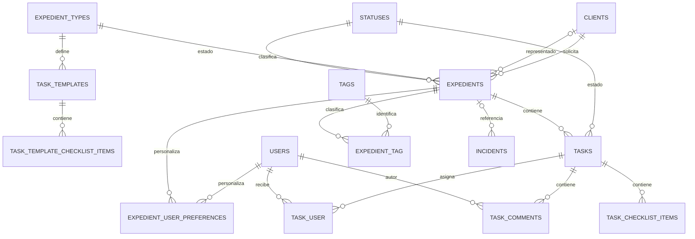

# Base de datos — diseño lógico previo a C

MySQL, InnoDB, utf8mb4, claves foráneas y constraints. Seleccionar versión MySQL soportada en A; CI usa el mismo motor y versión de referencia. Este documento define entidades e invariantes; las migraciones funcionales se implementan únicamente en C. Los nombres y tipos siguientes son propuestas técnicas, salvo los límites funcionales expresos.

## Catálogo

| Tabla | Campos lógicos principales / relaciones |
|---|---|
| `users` | id, name, email único, password hash, locale, campos técnicos; gestión de cuenta |
| `sessions`, `password_reset_tokens`, `personal_access_tokens` | Migraciones Laravel/Sanctum |
| `roles`, `permissions`, `model_has_roles`, `model_has_permissions`, `role_has_permissions` | Migraciones Spatie; un guard coherente para usuarios |
| `clients` | id, name único, marcas técnicas |
| `expedient_types` | id, name, code CHAR(2) único, marcas técnicas |
| `expedient_sequences` | year clave única, last_number 0–999 |
| `statuses` | id, nombre, orden global, marcas técnicas; catálogo compartido |
| `expedients` | id, code CHAR(9) único, year, sequence_number, expedient_type_id, name, description nullable, requester_client_id, represented_client_id nullable, status_id, marcas técnicas y soft delete |
| `expedient_user_preferences` | user_id, expedient_id, posición personal nullable, hidden, marcas técnicas; UNIQUE(user_id, expedient_id) |
| `tasks` | id, expedient_id, status_id, name, description nullable, fecha nullable, hora nullable, posición global, marcas técnicas y soft delete |
| `task_user` | task_id, user_id, UNIQUE(task_id,user_id) |
| `task_checklist_items` | id, task_id, name, completed, posición, marcas técnicas; sin fecha funcional |
| `task_comments` | id, task_id, user_id autor, body, marcas técnicas y estrategia de borrado |
| `task_templates` | id, expedient_type_id, name, description nullable, posición; sin usuarios ni fechas |
| `task_template_checklist_items` | id, task_template_id, name, posición |
| `tags` | id, name único, color configurable, marcas técnicas |
| `expedient_tag` | expedient_id, tag_id, UNIQUE de la pareja |
| `activity_log` | esquema del paquete de auditoría; actor, entidad, operación, cambios, fecha |
| `incidents` | id, user_id nullable, expedient_id nullable, tipo, operación, mensaje, contexto mínimo, created_at; conservar referencia histórica útil |

Incluir tablas auxiliares estándar Laravel solo si son necesarias (p. ej. cache/jobs). En C incorporar esquemas de dependencias de backend sin implementar todavía flujos de autenticación o negocio. No tablas de empresas, documentos, notificaciones ni calendario independiente.

## Relaciones

## Invariantes y criterios de diseño

- Código de tipo: dos dígitos ASCII preservando ceros; código expediente: nueve dígitos. Validar en aplicación y DB cuando sea viable. Índice único en code y `(year, sequence_number)`; campos inmutables tras asignación. Año según zona horaria de instalación. La fila de secuencia no se elimina al borrar expedientes. Definir transacción con `SELECT ... FOR UPDATE` (Eloquent `lockForUpdate`), alta concurrente segura de nueva fila anual y reintento acotado de deadlock; bloquear al superar 999. No reutilizar números de expedientes ya confirmados.
- Nombres únicos clientes y etiquetas: decidir collation y normalización (espacios, mayúsculas y acentos) explícitamente en C; testear según semántica seleccionada. No reutilizar claves de catálogo de forma que se pierda identidad histórica.
- Fecha/hora: propuesta `scheduled_date DATE NULL`, `scheduled_time TIME NULL`, constraint de hora solo con fecha. Representa una única fecha funcional; distinguir día completo de medianoche. No añadir fechas a expedientes, checklist o plantillas. Marcas técnicas en UTC donde corresponda; interpretar fecha/hora funcional en zona de instalación.
- Estados: FK restrictiva, también para filas soft deleted. No eliminar estado usado. Orden de columnas configurable. Seed inicial estable e idempotente que no restaure ni sobrescriba estados modificados por el usuario; definir traducciones de estados iniciales sin duplicar catálogos ni romper personalizaciones.
- Kanban expedientes: preferencias dispersas, sin fila por cada pareja al crear. Orden base determinista de entrada en columna (no basta `created_at` al mover); nueva entrada al final de cada orden personal. Implementar mediante claves de orden/versión de columna y preferencias vigentes, o actualización transaccional equivalente; invalidar posición antigua al cambiar estado y conservar `hidden`. Probar movimientos simultáneos, usuarios nuevos, tarjetas ocultas y ausencia de colisiones. Tareas: orden único por expediente/estado con desempate determinista.
- Soft Delete: distinguir las tareas eliminadas en cascada lógica por expediente de las borradas previamente (marcador de operación o FK auxiliar). Restaurar solo las primeras. Dependencias conservadas mientras se pueda restaurar el padre. Hard delete autorizado en backend, cascadas SQL o acciones explícitas documentadas; proteger catálogos referenciados. No asociar FK de borrado con operaciones Samba.
- Auditoría: diferencias relevantes, actor y referencia histórica; no incluir password/token ni contenido binario. Retención de un año con índice por fecha y limpieza programada. Incidencias no desaparecen por borrar expediente: referencia histórica segura y FK nullable si procede.
- Samba: propuesta ruta relativa original y estado operativo mínimo en expediente o entidad técnica dedicada, no inventario documental. No persistir rutas absolutas sensibles ni credenciales.

## Fase C — entregables

Diccionario definitivo de campos, tipos, nulabilidad, valores por defecto, índices, unicidad, FKs y reglas de borrado. Migraciones reversibles cuando sea razonable, modelos, relaciones, casts, factories, seeders idempotentes, fixtures sintéticas y pruebas. Verificar instalación vacía, migrate/rollback/migrate, restricciones DB directamente, relaciones, fechas, traducciones y catálogos. Casos de lógica de negocio que dependan de servicios posteriores se agregan cuando se implementen, sin fingir cobertura en C. No ejecutar `migrate:fresh` en producción.
